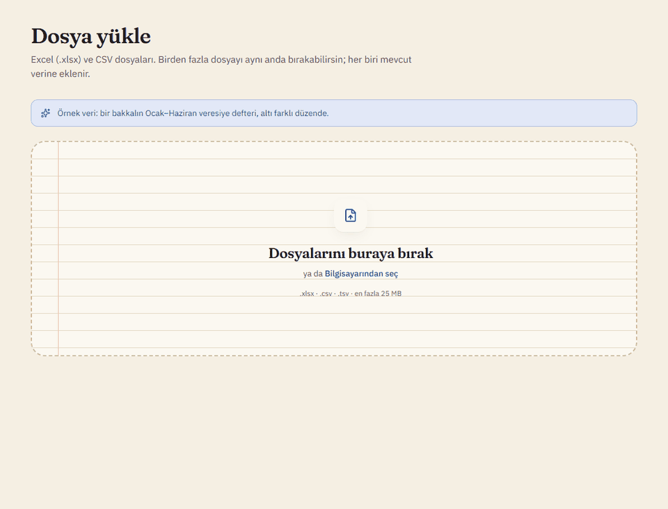
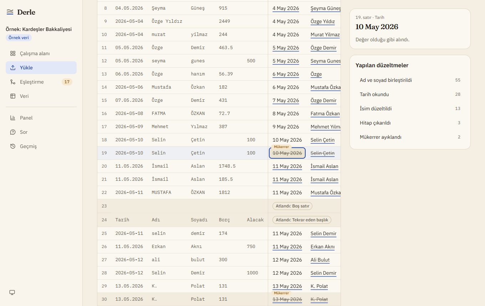
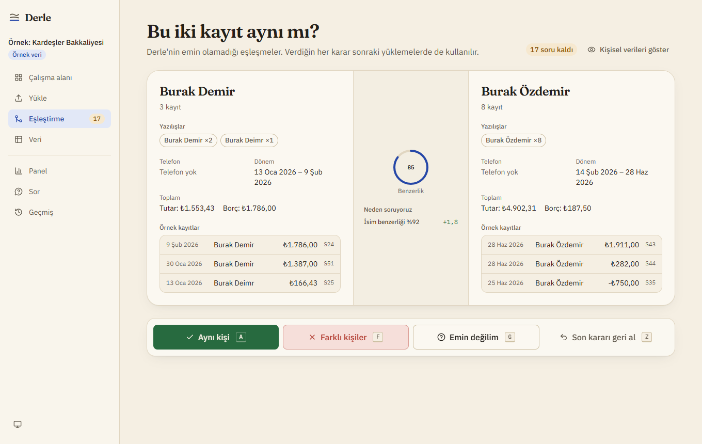
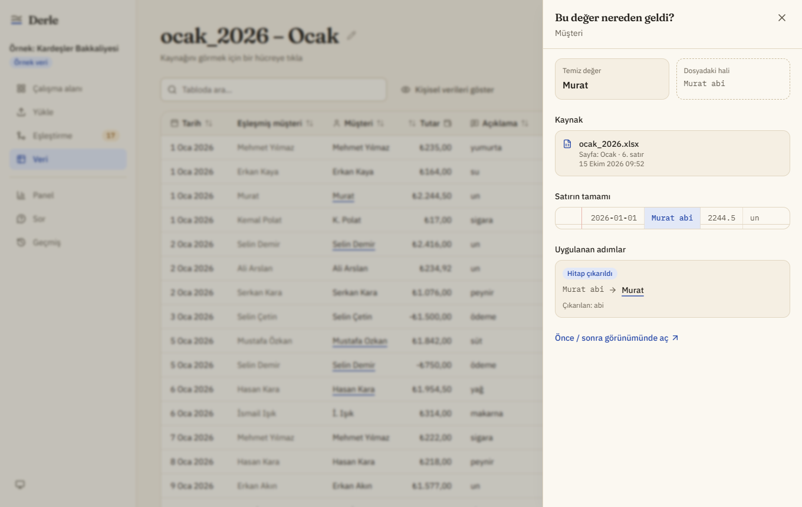
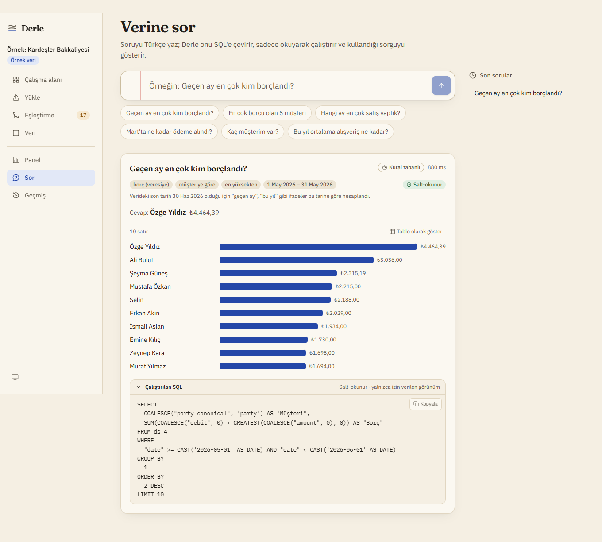
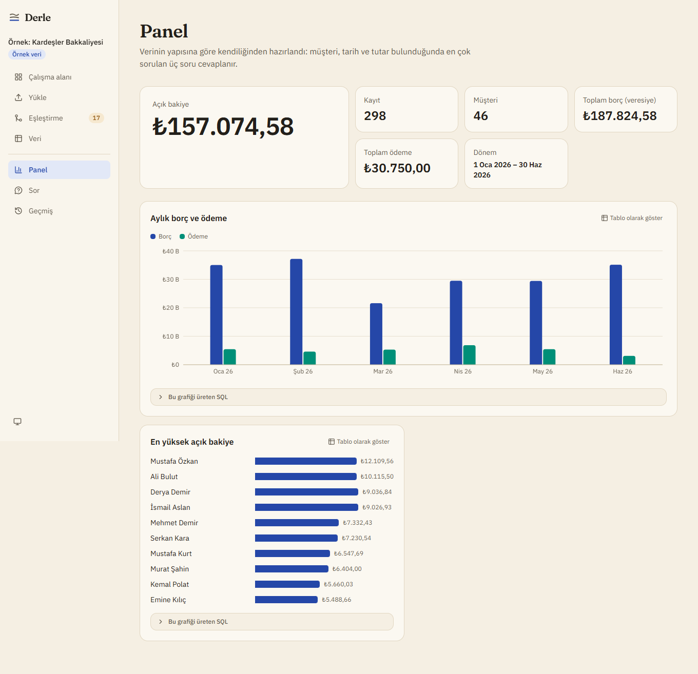
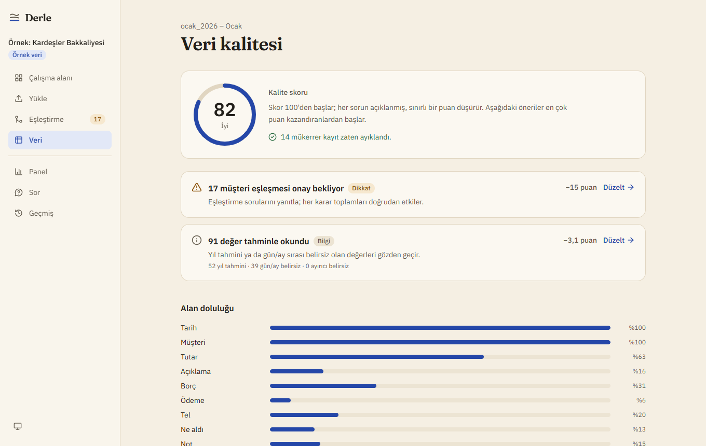
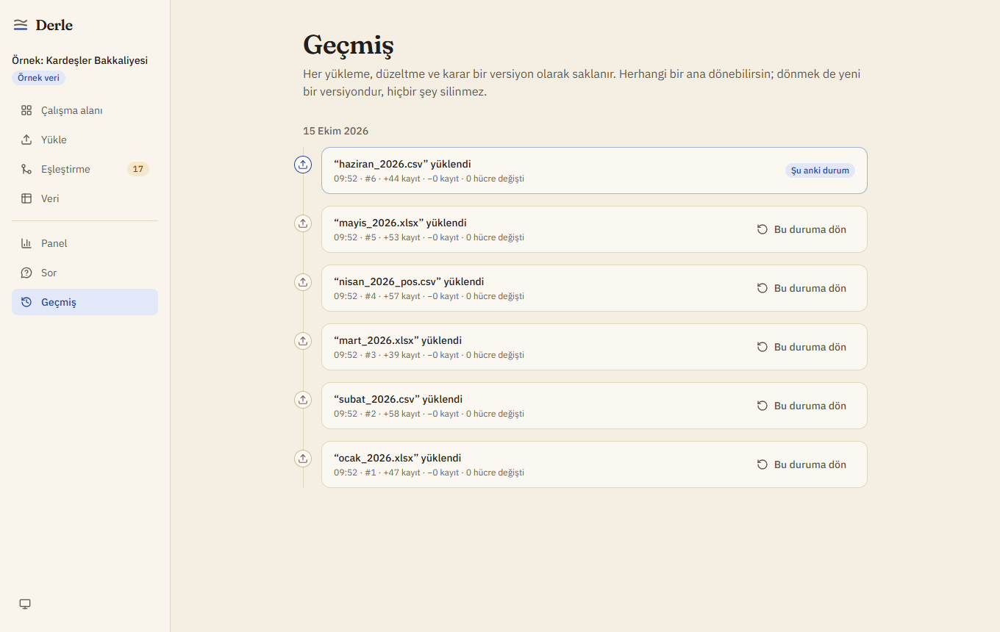
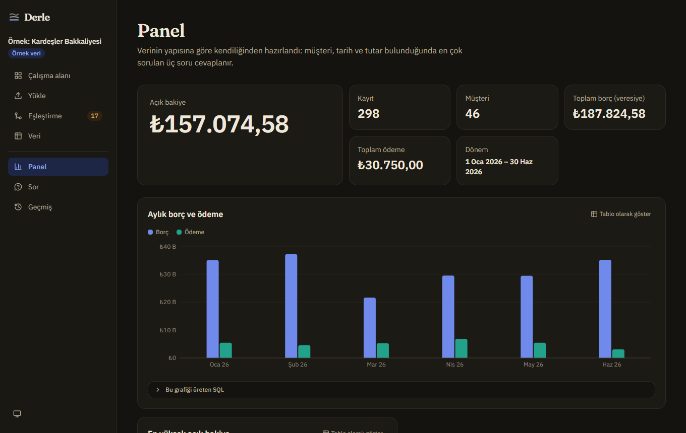
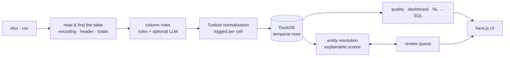

# Derle

**Turn scattered spreadsheets into a clean, persistent, explainable database.**
*Dağınık verini düzene sok.* · [Türkçe](README.tr.md)

[](https://github.com/aslizeya/derle/actions/workflows/ci.yml)




Small businesses (grocers, freelancers, small offices) keep their records in a different
Excel layout every month, semicolon CSVs from Turkish Excel, and notebook-style ledgers.
Derle reads all of it into **one versioned database**. It recognises what each column means,
normalises Turkish dates, numbers, names and phone numbers, removes duplicates, works out
that "Ahmet Yılmaz", "ahmet bey" and "A. Yılmaz" are the same customer, and can show,
for every clean value, the exact file, row and original text it came from.

## Why not just ask a chatbot or use a spreadsheet tool?

| | Chat with a file | Spreadsheet / no-code DB | **Derle** |
|---|---|---|---|
| Remembers last month's data and merges the new file into it | – | manual | **automatic, deduplicated** |
| Knows "ahmet bey" and "A. Yılmaz" are the same customer | sometimes, unexplained | – | **scored, explained, asks when unsure** |
| `1.234,56` vs `1,234.56`, "15 Mart", "5/3", I/İ/ı/i, bey/hanım | hit or miss | – | **dedicated, tested Turkish rules** |
| "Where did this number come from?" | – | – | **click any cell → file, row, original** |
| Undo one correction, or go back to last Tuesday | – | partial | **every change versioned, nothing deleted** |
| Shows the SQL behind an answer | – | – | **always, read-only by construction** |
| Works offline, AI optional | – | ✓ | **✓, rules first, AI only if enabled** |

## Try it

```bash
docker compose up --build
```

Open <http://localhost:3000> and click **Örnek veriyle dene** (*try with sample data*). It
loads a generated six-month grocery ledger: six different layouts, typos, honorifics,
initials, duplicates, a Windows-1254 CSV and a POS export. No account needed. Data stays in
a local Docker volume.

AI is optional. To let Claude label unusual columns and answer questions the rules do not
cover, put `DERLE_LLM_PROVIDER=anthropic` and `ANTHROPIC_API_KEY=…` in `.env` (see
[.env.example](.env.example)).

## A tour

| | |
|---|---|
|  **Before / after.** Every raw row next to its clean record; each correction is marked and can be undone. |  **"Are these the same?"** Uncertain matches with the evidence and its weights; answer with <kbd>A</kbd> / <kbd>F</kbd> / <kbd>G</kbd>, undo with <kbd>Z</kbd>. |
|  **Provenance.** Click any value: file, sheet, row, the original text and every step applied to it. |  **Ask in Turkish.** *"Geçen ay en çok kim borçlandı?"*: answer, chart, how the question was read, and the SQL that ran. |
|  **Automatic dashboard.** Chosen from the detected schema: open balance, monthly debt vs. payments, top balances. |  **Data quality.** A 0–100 score from documented penalties, with links to fix each issue. |
|  **History.** Every upload, decision and undo is a version; restoring is a new version too. |  **Dark mode, phones, keyboard.** Validated chart palette, WCAG AA contrast, bottom navigation on mobile. |

## Benchmark

`tools/benchmark/run.py` generates deliberately messy ledgers with known ground truth, runs
them through the real pipeline, and measures the result. A simulated reviewer then answers
the "same customer?" cards using the ground truth, to measure what human-in-the-loop review
adds and how much of it is needed.

<!-- benchmark:start -->
Mean over 5 generated ledgers (seeds 1, 2, 3, 4, 5); each has 6 files, ~324 rows and 40 customers. Rules only, no LLM. Total runtime 13.6s.

**Normalization**

| Rows recovered | Dates correct | Amounts correct | Duplicate removal F1 |
|---|---|---|---|
| 100.0% | 100.0% | 100.0% | 1.000 |

**Entity resolution** (pairwise, over records)

| Stage | Precision | Recall | F1 | Entities found |
|---|---|---|---|---|
| Automatic (rules) | 0.938 | 0.862 | **0.898** | 49.4 |
| After answering 11 review cards | 0.918 | 0.940 | **0.929** | 39.8 |
| *True customers* | | | | *40* |

Blocking compared 491 of 7673 possible name pairs.
<!-- benchmark:end -->

These numbers come from the project's own generator, which covers the patterns Derle is
built for. Real files will be messier; the known limits are listed below.

## How it works



* **One store, two shapes.** A long, temporal `cells` table (record × field, with raw value
  and source columns) gives provenance and undo; generated `ds_<id>` views give one typed
  column per field for analytics. ([ADR-0002](docs/adr/0002-duckdb-single-store.md))
* **Nothing is ever deleted.** Uploads, corrections, decisions, undos and restores all open
  a new version; history is plain SQL. ([ADR-0003](docs/adr/0003-temporal-versioning.md))
* **Rules first, AI optional.** Every feature has a deterministic path; the LLM only upgrades
  low-confidence results and is validated by Pydantic schemas.
  ([ADR-0004](docs/adr/0004-rules-first-optional-llm.md))
* **Explainable matching.** Additive evidence (name similarity, typo, initials, first name
  only, phone) → logistic score; decisions become must-link / cannot-link constraints.
  ([ADR-0005](docs/adr/0005-explainable-entity-resolution.md))
* **Safe questions.** Generated SQL passes a sqlglot AST guard (one SELECT, allowed view
  only, no table/file functions, always a LIMIT) *and* runs on a connection with DuckDB
  external access disabled. ([ADR-0006](docs/adr/0006-transparent-read-only-nlq.md))
* **The animation is real.** The upload screen paces the pipeline's actual Server-Sent
  Events, never a scripted sequence.

More detail in [docs/architecture.md](docs/architecture.md).

## Tech

**Backend:** Python 3.12 · FastAPI · DuckDB · Pydantic · rapidfuzz · sqlglot · openpyxl ·
Anthropic SDK (optional)
**Frontend:** Next.js 16 (App Router) · TypeScript · Tailwind CSS 4 · Radix primitives ·
TanStack Query & Table · Recharts · motion · next-intl
**Quality:** pytest + Hypothesis (338 tests) · Playwright + axe end-to-end tests · ruff ·
mypy `--strict` · ESLint · OpenAPI-generated TypeScript types with a drift check in CI

## Development

```bash
# API
cd apps/api
python -m venv .venv && source .venv/bin/activate   # Windows: .venv\Scripts\activate
pip install -e ".[dev,llm]"
pytest
uvicorn derle.main:app --reload --app-dir src --timeout-keep-alive 75

# Web (proxies /api to http://localhost:8000)
cd apps/web
npm install
npm run dev
npm run gen:api            # after changing the API: regenerate the typed client
npm run e2e                # Playwright + axe, on their own ports and a temporary database

# Benchmark and sample data
python tools/benchmark/run.py --update-readme
python tools/sample_data/generate.py --out data/sample

# README media
cd apps/web && npm run capture && cd ../.. && python tools/media/make_gif.py
```

```
apps/api    FastAPI service: ingest, normalize/tr, semantics, matching, analytics, nlq, services
apps/web    Next.js app: features/* (upload, review, matching, table, dashboard, ask, history)
tools       sample-ledger generator, benchmark, GIF assembly
docs        architecture, ADRs, screenshots
```

## Known limits

* Two different customers written with the same first name only and no phone
  ("Mehmet abi") share one name profile and cannot be told apart yet; this is the main
  remaining precision loss in the benchmark.
* The rule-based question parser covers ledger questions (debt, payments, balance, counts,
  customers, months, periods). Anything else needs the optional LLM.
* Single user per installation; DuckDB allows one writer process.

## Roadmap

* WhatsApp chat exports as a source (a new `SourceReader`; the pipeline is unchanged)
* Photos of handwritten ledgers via OCR
* Multi-user accounts (every table already carries `workspace_id`)
* More languages (all UI text lives in `apps/web/src/messages/<locale>.json`)

## License

[MIT](LICENSE)
