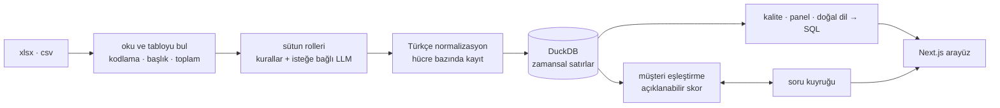

# Derle

**Dağınık verini düzene sok.**
*Excel'ler, CSV'ler, veresiye defterleri → temiz, kalıcı ve açıklanabilir bir veritabanı.* · [English](README.md)


Esnaf, serbest çalışanlar ve küçük ofisler kayıtlarını her ay başka düzende tutulmuş
Excel'lerde, Türkçe Excel'in noktalı virgüllü CSV'lerinde ve defter usulü listelerde tutar.
Derle bunların hepsini **tek, versiyonlu bir veritabanında** birleştirir:

* Sütunların ne anlama geldiğini bulur.
* Türkçe tarihleri, sayıları, isimleri ve telefonları tek biçime getirir.
* Mükerrer kayıtları ayıklar.
* "Ahmet Yılmaz", "ahmet bey" ve "A. Yılmaz"ın aynı müşteri olduğunu anlar.
* Her temiz değerin hangi dosyanın hangi satırından geldiğini ve orijinal halini gösterir.

## Neden sohbet botu ya da tablo aracı değil?

| | Dosyayı yapay zekâya sormak | Tablo aracı / no-code DB | **Derle** |
|---|---|---|---|
| Geçen ayın verisini hatırlar, yeni dosyayı ona ekler | – | elle | **otomatik, mükerrersiz** |
| "ahmet bey" ile "A. Yılmaz"ın aynı kişi olduğunu bilir | bazen, gerekçesiz | – | **puanlı, gerekçeli, emin değilse sorar** |
| `1.234,56` / `1,234.56`, "15 Mart", "5/3", I/İ/ı/i, bey/hanım | şansa bağlı | – | **Türkçe'ye özel, testli kurallar** |
| "Bu sayı nereden geldi?" | – | – | **hücreye tıkla → dosya, satır, orijinal** |
| Tek bir düzeltmeyi ya da geçen salıyı geri al | – | kısmen | **her değişiklik versiyonlu, hiçbir şey silinmez** |
| Cevabın arkasındaki SQL'i gösterir | – | – | **her zaman, yapısı gereği salt-okunur** |
| İnternetsiz çalışır, yapay zekâ isteğe bağlı | – | ✓ | **✓, önce kurallar, AI sadece açıksa** |

## Dene

```bash
docker compose up --build
```

<http://localhost:3000> adresini aç ve **Örnek veriyle dene** butonuna tıkla. Bir
bakkalın üretilmiş 6 aylık veresiye defteri yüklenir. Altı ayrı düzende yazılmış; yazım
hataları, hitaplar, baş harfler, mükerrer kayıtlar, Windows-1254 kodlamalı bir CSV ve bir POS
dökümü içerir. Hesap açmak gerekmez, veriler yerel bir Docker volume'unda kalır.

Yapay zekâ isteğe bağlıdır. Claude'un sıra dışı sütunları etiketlemesini ve kuralların
anlamadığı soruları cevaplamasını istersen `.env` dosyasına
`DERLE_LLM_PROVIDER=anthropic` ve `ANTHROPIC_API_KEY=…` yaz ([.env.example](.env.example)).

## Kısa tur

| | |
|---|---|
|  **Önce / sonra.** Ham satır ve temiz kayıt yan yana; her düzeltme işaretli ve geri alınabilir. |  **"Bu ikisi aynı mı?"** Kanıtlar ağırlıklarıyla; <kbd>A</kbd> aynı, <kbd>F</kbd> farklı, <kbd>G</kbd> atla, <kbd>Z</kbd> geri al. |
|  **Kaynak izlenebilirliği.** Bir değere tıkla: dosya, sayfa, satır, orijinal metin ve uygulanan her adım. |  **Türkçe sor.** *"Geçen ay en çok kim borçlandı?"* Cevap, grafik, sorunun nasıl anlaşıldığı ve çalıştırılan SQL. |
|  **Otomatik panel.** Bulunan şemaya göre: açık bakiye, aylık borç/ödeme, en yüksek bakiyeler. |  **Veri kalitesi.** Açıklanmış puan kesintileriyle 0–100 skor ve her sorun için "düzelt" bağlantısı. |
|  **Geçmiş.** Her yükleme, karar ve geri alma bir versiyon; geri dönmek de yeni bir versiyon. |  **Karanlık mod, telefon, klavye.** Doğrulanmış grafik paleti, WCAG AA kontrast, mobilde alt menü. |

## Benchmark

`tools/benchmark/run.py`, doğru cevabı bilinen ve bilerek dağınık üretilmiş defterleri gerçek
veri hattından geçirip ölçer. Ardından simüle edilmiş bir kullanıcı "aynı müşteri mi?"
sorularını gerçek cevaplarla yanıtlar. Böylece insan onayının ne kattığı ve kaç soru
gerektiği de ölçülür.

<!-- benchmark:start -->
Üretilmiş 5 defterin ortalaması (seed 1, 2, 3, 4, 5); her biri 6 dosya, ~324 satır ve 40 müşteri. Yalnızca kurallar, LLM yok. Toplam süre 13.6 sn.

**Normalizasyon**

| Bulunan satır | Doğru tarih | Doğru tutar | Mükerrer ayıklama F1 |
|---|---|---|---|
| %100,0 | %100,0 | %100,0 | 1.000 |

**Müşteri eşleştirme** (kayıt çiftleri üzerinden)

| Aşama | Precision | Recall | F1 | Bulunan müşteri |
|---|---|---|---|---|
| Otomatik (kurallar) | 0.938 | 0.862 | **0.898** | 49.4 |
| 11 soru cevaplandıktan sonra | 0.918 | 0.940 | **0.929** | 39.8 |
| *Gerçek müşteri sayısı* | | | | *40* |

Blocking ile 7673 olası isim çiftinin yalnızca 491 tanesi karşılaştırıldı.
<!-- benchmark:end -->

Bu sonuçlar projenin kendi örnek veri üretecinde ölçülmüştür. Üreteç, Derle'nin hedeflediği
durumları kapsar; gerçek dosyalar daha dağınık olabilir. Bilinen sınırlar aşağıda.

## Nasıl çalışır



* **Tek depo, iki görünüm.** Ham değeri ve kaynak sütunlarıyla tutulan zamansal `cells`
  tablosu kaynak izlenebilirliği ve geri almayı sağlar. Üretilen `ds_<id>` görünümleri
  analiz için her alana tipli bir sütun verir.
  ([ADR-0002](docs/adr/0002-duckdb-single-store.md))
* **Hiçbir şey silinmez.** Yükleme, düzeltme, karar, geri alma ve geri dönme yeni bir versiyon
  açar; geçmiş düz SQL ile okunur. ([ADR-0003](docs/adr/0003-temporal-versioning.md))
* **Önce kurallar, AI isteğe bağlı.** Her özelliğin deterministik bir yolu vardır. LLM yalnızca
  düşük güvenli sonuçları iyileştirir ve çıktısı Pydantic şemalarıyla doğrulanır.
  ([ADR-0004](docs/adr/0004-rules-first-optional-llm.md))
* **Açıklanabilir eşleştirme.** Toplanabilir kanıtlar (isim benzerliği, yazım hatası, baş
  harf, sadece ad, telefon) lojistik bir skora dönüşür. Kararlar zorunlu bağ / yasak bağ
  kısıtlarına dönüşür. ([ADR-0005](docs/adr/0005-explainable-entity-resolution.md))
* **Güvenli sorgu.** Üretilen SQL iki katmandan geçer: sqlglot ile söz dizimi denetimi (tek
  SELECT, sadece izinli görünüm, tablo/dosya fonksiyonu yok, her zaman LIMIT) ve dosya
  erişimi kapatılmış bir DuckDB bağlantısı.
  ([ADR-0006](docs/adr/0006-transparent-read-only-nlq.md))
* **Animasyon gerçektir.** Yükleme ekranı veri hattının gerçek olaylarını (Server-Sent Events)
  okunabilir hızda gösterir; hazır senaryo yoktur.

Ayrıntılar: [docs/architecture.md](docs/architecture.md).

## Teknolojiler

**Backend:** Python 3.12 · FastAPI · DuckDB · Pydantic · rapidfuzz · sqlglot · openpyxl ·
Anthropic SDK (isteğe bağlı)
**Frontend:** Next.js 16 (App Router) · TypeScript · Tailwind CSS 4 · Radix · TanStack Query
ve Table · Recharts · motion · next-intl
**Kalite:** pytest + Hypothesis (338 test) · Playwright + axe uçtan uca testler · ruff ·
mypy `--strict` · ESLint · OpenAPI'den üretilen TypeScript tipleri ve CI'da sözleşme kontrolü

## Geliştirme

```bash
# API
cd apps/api
python -m venv .venv && source .venv/bin/activate   # Windows: .venv\Scripts\activate
pip install -e ".[dev,llm]"
pytest
uvicorn derle.main:app --reload --app-dir src --timeout-keep-alive 75

# Web (/api isteklerini http://localhost:8000'e yönlendirir)
cd apps/web
npm install
npm run dev
npm run gen:api            # API değiştiğinde tipli istemciyi yeniden üret
npm run e2e                # Playwright + axe; ayrı portlar ve geçici veritabanı

# Benchmark ve örnek veri
python tools/benchmark/run.py --update-readme
python tools/sample_data/generate.py --out data/sample

# README görselleri
cd apps/web && npm run capture && cd ../.. && python tools/media/make_gif.py
```

```
apps/api    FastAPI servisi: ingest, normalize/tr, semantics, matching, analytics, nlq, services
apps/web    Next.js uygulaması: features/* (upload, review, matching, table, dashboard, ask, history)
tools       örnek defter üreteci, benchmark, GIF oluşturma
docs        mimari, ADR'ler, ekran görüntüleri
```

## Bilinen sınırlar

* Telefonu olmayan ve sadece adıyla yazılmış iki farklı müşteri ("Mehmet abi") aynı isim
  profilini paylaşır ve henüz ayırt edilemez. Benchmark'taki precision kaybının ana kaynağı
  budur.
* Kural tabanlı soru motoru defter sorularını kapsar: borç, ödeme, bakiye, sayılar, müşteriler,
  aylar ve dönemler. Diğer sorular için isteğe bağlı LLM gerekir.
* Kurulum başına tek kullanıcı vardır; DuckDB tek bir yazıcı süreç kabul eder.

## Yol haritası

* Kaynak olarak WhatsApp sohbet dökümleri (yeni bir `SourceReader`; veri hattı değişmez)
* Elle tutulmuş defter fotoğraflarından OCR
* Çok kullanıcılı hesaplar (her tablo zaten `workspace_id` taşıyor)
* Yeni diller (tüm arayüz metni `apps/web/src/messages/<dil>.json` içinde)

## Lisans

[MIT](LICENSE)
