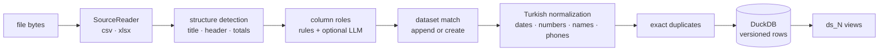
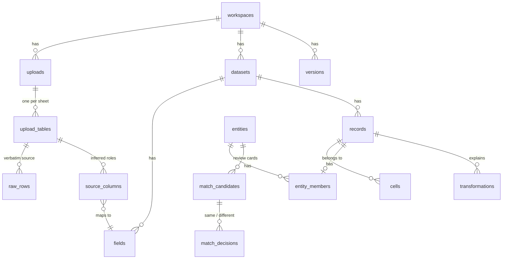
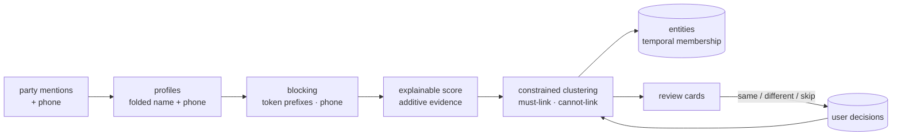

# Architecture

Derle turns scattered spreadsheets into a clean, persistent, explainable database. This
document describes the moving parts; the *why* behind each major choice lives in
[`docs/adr/`](adr/).

## Repository layout

```
apps/api     FastAPI backend (Python 3.12+): ingestion, normalization, matching, analytics
apps/web     Next.js frontend (App Router, TypeScript, Tailwind, shadcn-style UI)
tools/       sample data generator and benchmark CLIs
docs/        architecture notes and ADRs
```

## Ingestion pipeline



| Stage | Module | Notes |
|---|---|---|
| Read | `ingest/csv_reader.py`, `ingest/excel_reader.py` | Encoding sniffing (UTF-8/BOM/UTF-16/cp1254), delimiter sniffing, Excel native types kept |
| Structure | `ingest/structure.py` | Header scored by vocabulary + text-likeness; title, blank, total and repeated-header rows skipped and recorded |
| Roles | `semantics/infer.py`, `semantics/llm_refine.py` | Header vocabulary + value profiling, each with a `Reason`; LLM may only upgrade low-confidence columns |
| Normalize | `normalize/engine.py`, `normalize/tr/*` | Column-level context first (number style, date order, default year), then per-cell parsing with a transformation log |
| Persist | `services/ingest.py`, `storage/*` | One transaction and one `version_id` per upload |

Every step emits a `PipelineEvent` (`column_recognized`, `duplicates_removed`, …). The upload
animation in the UI is driven by these real events, not by a scripted sequence.

## Data model



* **raw_rows** are immutable. They are what "show me the original" reads.
* **records / cells** are *temporal*: `version_from` / `version_to`. Current state is
  `version_to IS NULL`. Undo, manual edits and "restore version N" close rows and open new
  ones; nothing is deleted (ADR-0003).
* **cells** carry `raw_value` and `src_cols`, so any clean value links back to file → sheet →
  row → column (provenance).
* **transformations** log every change (`date_parsed`, `currency_stripped`,
  `honorific_removed`, `duplicate_removed`, …) with before/after, confidence and details.
* **ds_N** views pivot cells into one typed column per field. Tables, dashboards and
  natural-language queries read only these.

## Entity resolution



Resolution runs after every upload, decision and undo, always from scratch. The result is
a pure function of (current records, active decisions), so undoing a decision or an
upload never leaves stale merges behind. See ADR-0005 and `matching/`.

Datasets with a party column expose `party_id` and `party_canonical` in their `ds_N` view,
so queries group by the real customer instead of by spelling.

## Frontend

* **Next.js App Router** with client-side data fetching through TanStack Query. The browser
  only talks to the web origin; `next.config.ts` proxies `/api/v1/*` to the API, so the API
  never needs public CORS.
* **Typed contract.** `npm run gen:api` dumps FastAPI's OpenAPI schema (no running server
  needed) and generates `src/lib/api/schema.d.ts`; `openapi-fetch` uses it, so a backend
  change that breaks the UI fails `tsc`.
* **Live uploads.** `POST /workspaces/{id}/uploads/stream` answers with Server-Sent Events.
  `EventSource` cannot POST, so `lib/api/stream.ts` reads the stream by hand. The animation
  paces the *real* events (`usePacedCount`); nothing on screen is scripted.
* **i18n.** next-intl with a typed Turkish catalog (`src/messages/tr.json`). Components use
  keys only; the backend sends codes (`column_recognized`, `honorific_removed`, …), never
  sentences.
* **Design system.** Colour, type and spacing tokens live in `globals.css` (`@theme`). Dark
  mode swaps the palette. Fraunces for display, IBM Plex Sans/Mono for text and data, tabular
  numerals in every table.

| Route | Screen |
|---|---|
| `/` | Landing with animated before/after, "Örnek veriyle dene" |
| `/w/[ws]` | Workspace: stats, datasets, recent uploads, pending-question callout |
| `/w/[ws]/yukle` | Drag & drop upload with live recognition animation |
| `/w/[ws]/yuklemeler/[id]` | Before/after review, column mapping, change list, undo |
| `/w/[ws]/eslestirme` | "Are these the same?" queue with keyboard shortcuts |
| `/w/[ws]/veri/[id]` | Clean table: server-side sort/search, PII masking, provenance panel, export, rename |
| `/w/[ws]/veri/[id]/kalite` | Quality report: score, issues with fix links, field completeness |
| `/w/[ws]/panel` | Auto dashboard: KPIs, monthly debt/payment columns, top open balances |
| `/w/[ws]/sor` | Natural-language questions with answer, chart, explanation and the SQL that ran |
| `/w/[ws]/gecmis` | Version timeline with restore |

## Analytics

| Module | What it does |
|---|---|
| `analytics/schema.py` | The money model: sales, payments and balance from any mix of amount/debit/credit columns |
| `analytics/quality.py` | 0–100 score from capped, documented penalties, plus issues that link to where they are fixed |
| `analytics/dashboard.py` | KPI tiles and charts chosen from the detected schema; every widget carries its SQL |
| `nlq/rules.py`, `nlq/llm.py` | Turkish question → plan → SQL (rules first, optional LLM fallback) |
| `nlq/guard.py` | sqlglot AST check: one SELECT over the allowed view, no table/file functions, always a LIMIT |
| `services/history.py` | Version timeline and point-in-time restore (a restore is itself a new version) |
| `services/export.py` | Typed Excel (₺ and date formats) and portable CSV, optionally PII-masked |

User-facing SQL runs on a connection with DuckDB external access disabled (ADR-0006).

## AI is optional

`llm/base.py` defines a provider protocol. `NullProvider` is the default, and every caller
treats `None` as "use rules". With `DERLE_LLM_PROVIDER=anthropic` and an API key, Claude
labels uncertain columns through structured outputs validated by Pydantic (ADR-0004).

## Extension points (next release)

* **WhatsApp exports / notebook photos (OCR)**: implement `SourceReader` and return
  `RawGrid`s. Everything downstream is unchanged.
* **Multi-user**: every table already carries `workspace_id`, so an auth layer only has to
  map users to workspaces.
